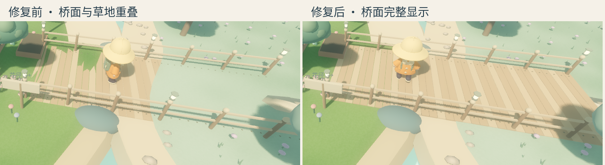

# 桥头闪烁修复

状态：DONE。截图中的桥头三角形缺口来自桥面与地形共面时的深度争用（z-fighting）。

三座桥的木板顶面原为 `y = 0.12`，与主岛草地顶面重合，低于外岛草地 `0.125` 和北侧沙岸 `0.135`。摄像机跟随角色移动时，重合处会交替显示木板和草地。

`/scripts/expanded_island.gd` 将木板顶面统一调整到 `0.16`，钉子随木板一起移动。独立碰撞面仍为 `0.12`，保持桥与岛屿之间平整的行走路径。



## 验证

- Godot 4.7.2 / Metal Forward+ / Apple M2 实际渲染，复现原截图中的桥头缺口。
- 新增 `tests/bridge_surfaces.gd` 检查三座桥的全部木板、钉子及行走碰撞面。修复前六组木板检查失败，修复后全部通过。该测试需要真实渲染器，不能使用不保存 MultiMesh 变换的 headless dummy 后端。
- 渲染检查覆盖三座桥共六个接岸处。
- 使用实际移动输入从花径桥头 `(12, 1, 3)` 走至 `(18.63047, 0.91955, 3.000019)`，记录移动过程的十帧画面。桥面完整、角色保持着地。
- 原有测试通过：smoke、jump、wave_dash、camera、save_state、progress_integration、menus、ui_layout、navigation、expanded_world、music。执行期间工程有其他功能更新；smoke、wave_dash、save_state 在这些更新完成后重新通过。

桥面专项检查：

```sh
godot --path . --max-fps 60 --script res://tests/bridge_surfaces.gd
```

输出：

```text
PASS: all three bridges clear grass and sand, every plank and nail aligns, continuous walking decks remain level
```

可在命令末尾添加 `-- /tmp/bridge-after`，输出六个接岸处截图。此修复已写入工程源码；独立 `.app` 和 ZIP 未在本次修复中重新导出。
